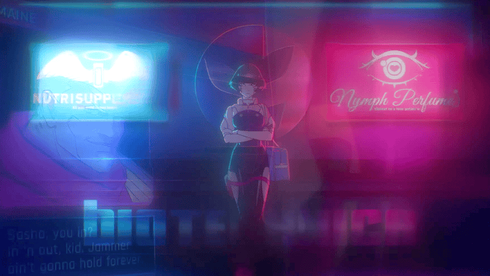

  

  

## 👨‍💻 Sobre mí
- 🔭 Trabajo en proyectos de visión por computadora y machine learning
- 🌐 Desarrollo full-stack (Laravel, Node.js) y despliegues en la nube
- 🌱 Siempre aprendiendo algo nuevo
- ⚡ Pregúntame sobre: detección de objetos, bases de datos, o cualquier cosa de código

## 🎲 Datos curiosos
- 🎮 Juego favorito: **Cyberpunk**
- 🎧 Música que escucho: **Dreamwave**
- 🎬 Anime / serie del momento: **Cowboy bep bop**

## 🛠️ Tecnologías

  

  
  
  

## 🚀 Proyectos destacados
- 💊 [Farmacia-Nova](https://github.com/jeyson160206/Farmacia-Nova) — Aplicación web en JavaScript
- 🔐 [Deteccion Obj](https://github.com/jeyson160206/Diia_software) — Detección de Objetos
<!-- Aquí agrega tus proyectos de YOLOv8 cuando los subas -->

  

## 📖 De *La metamorfosis*

  

— Franz Kafka, <i>La metamorfosis</i>

## 📲 Encuéntrame aquí

  
  

